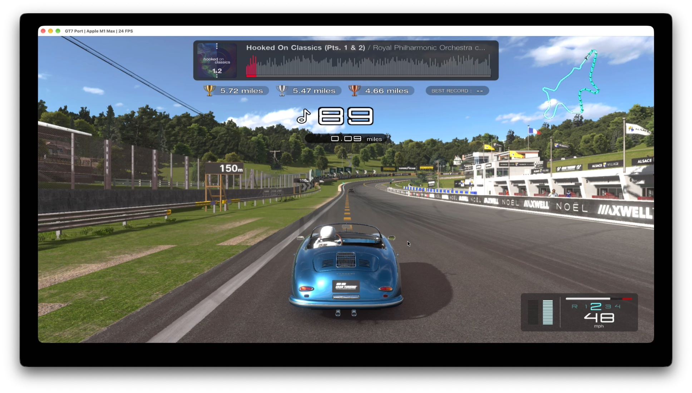

# GT7 Port for Apple Silicon

**Gran Turismo 7** (PS4, CUSA24769, v1.00) running natively on **Apple Silicon Macs**
under Rosetta 2, with a GCN-to-Metal renderer.

> *Not affiliated with or endorsed by Sony Interactive Entertainment or Polyphony
> Digital. "Gran Turismo" and "PlayStation" are trademarks of their owners. No game
> files, keys or decryption tools are included: you need your own legitimate copy of
> the game.*



*Music Rally at Alsace Village on a MacBook Pro M1 Max under Rosetta 2, 24 fps (2026-11-09).*

**Status: work in progress.** Boot, menus, display settings and races work. In a race
on an M1 Max it runs at roughly 20-30 fps, with visual differences from the console and
shader-compile stutters the first time a scene is seen. Current state, recent work and
next steps (in Italian): **[docs/GT7_STATUS.md](docs/GT7_STATUS.md)**.

## How it works

This is not a general-purpose emulator. PS4 code is x86-64: under Rosetta 2 it runs
directly, without a CPU recompiler of our own. Only what is console-specific is
replaced: Sony's system libraries (HLE) and the AMD Liverpool GPU (PM4 command
processor, GCN shaders translated to Metal Shading Language).

The runtime started as the Apple Silicon fork of
[Driveclub-Port](https://github.com/BlackLineInteractive/Driveclub-Port)
([fladnaG86/Driveclub-Port-AppleSilicon](https://github.com/fladnaG86/Driveclub-Port-AppleSilicon)).
This repository carries the GT7 work on top of it: comments about Driveclub in the
code describe where a technique came from.

```
eboot.bin (x86-64, executed directly under Rosetta 2)
   │  imports from Sony system libraries
   ▼
HLE libraries ── libkernel, libc, Fiber, Pad, AudioOut, VideoOut, SaveData, Net/NP (offline)
   │  sceGnmSubmitCommandBuffers
   ▼
GPU frontend ── PM4 parsing, register state, GCN shaders -> IR
   │  src/gpu/renderer.h
   └──► Metal (src/gpu/metal): IR -> MSL, pipeline cache and prewarm
```

GT7-specific parts include:

- **Address space:** GT7 v1.00 puts its 16 GB memory arenas and its two PRT apertures
  in the range Rosetta 2 cannot map; the runtime moves them (`src/core/runtime.cpp`).
- **HLE:** fibers, batch/direct memory mapping, event flags, save data memory, offline
  PSN state and the other libraries GT7 needs beyond Driveclub.
- **GPU:** chained indirect buffers, compute ring interrupts, PRT (tiled) textures,
  tessellation, geometry shaders emulated with compute, F64 ops emulated with integers,
  wave-uniform branches for cross-lane votes.
- **Stutters:** pipelines seen in earlier sessions are compiled at start-up from a
  manifest (`~/Library/Caches/GT7Port/render_pipelines*.bin`).
- **Debugging:** GPU frame capture and offline replay (`DC_CAPTURE*`,
  `DC_FRAME_REPLAY`), game logger hook (`DC_GAME_LOG=1`), recorded pad input.

## Requirements

- Apple Silicon Mac, macOS 15 or later, Rosetta 2
- Xcode, CMake >= 3.24, Ninja, an x86_64 build of SDL3
- Your own decrypted dump of GT7 v1.00 (CUSA24769): `eboot.bin`, `sce_module` and the
  33 `gtNN.vol` data files (about 88 GB) in `contents`

## Build

The binary is always x86_64 (guest code runs on the host CPU through Rosetta 2), so
SDL3 must be an x86_64 build too:

```bash
cmake -S . -B build -G Ninja -DSDL3_DIR=<x86_64 SDL3 prefix>/lib/cmake/SDL3
cmake --build build
```

## Run

```bash
DC_OFFLINE=1 arch -x86_64 ./build/gt7 <game folder with eboot.bin>
```

`DC_OFFLINE=1` is required: there is no PSN emulation and the game only gets past
start-up signed out. Saves go to `~/Library/Application Support/GT7Port`; set `HOME` to
another folder to keep separate profiles. If loading stops at *INITIALIZING*, start
again.

`tools/app/make_app.sh <version>` packages `build/gt7` as `GT7.app` in a `.dmg`; launched
from Finder it asks for the game folder, runs offline and writes one log per session to
`~/Desktop/GT7 Logs`.

## Game files

Game files are not included and must never be committed (see `.gitignore`). Unpacking
your own decrypted package:

```bash
tools/extract.sh <path_to_pkg> extracted
```

Imports of the executable by library:

```bash
tools/elfinfo.py extracted/Image0/eboot.bin
tools/elfinfo.py extracted/Image0/eboot.bin --lib libSceGnmDriver
```

## Legal

- **No proprietary game files:** this project does not distribute, host or link to
  copyrighted material, game assets, PKG dumps, executables (`eboot.bin`), libraries
  (`.prx`), data archives (`.vol`), audio or textures. Users must provide their own
  legitimately acquired copy of Gran Turismo 7.
- **Intellectual property:** Gran Turismo is a registered trademark of Sony Interactive
  Entertainment Inc. All trademarks, game titles and copyrighted assets belong to Sony
  Interactive Entertainment and Polyphony Digital.
- **Purpose:** an independent reverse-engineering project for interoperability,
  software preservation and education. It is not affiliated with, endorsed by or
  sponsored by Sony Interactive Entertainment, Polyphony Digital or any associated
  entity.

## License

GNU General Public License v2.0 or later (GPL-2.0-or-later), see [LICENSE](LICENSE).

## Acknowledgments

- [Driveclub-Port](https://github.com/BlackLineInteractive/Driveclub-Port)
  (BlackLineInteractive): the runtime and Metal renderer this port builds on.
- [ryGT7](https://gitlab.com/rygt-team/rygt7): reference for GT7's HLE needs and GPU
  behaviour.
- [shadPS4](https://github.com/shadps4-emu/shadPS4): the main source of knowledge on ELF
  loading, HLE libraries, PM4 and GCN shader recompilation.
- [OpenGNM](https://ps4-opengnm.github.io/opengnm/): documentation on PS4 Gnm and GCN
  shaders.
